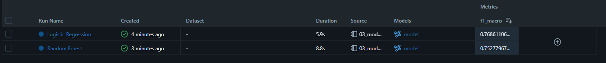

# Personality Type Predictor

Predicts a person's personality type (**Moderate**, **Resilient**, **Overcontroller** or **Undercontroller**) from 19 short Big Five questionnaire answers (scale 1 to 5) plus age, gender and writing hand. The models are tuned and tracked with MLflow, and the best model is served in a Streamlit web app.

## Project structure

```
personality-predictor/
├── data/
│   ├── data.csv              # raw dataset (IPIP Big Five, Kaggle)
│   ├── data_processed.csv    # cleaned data, written by 01_eda, read by 02 and 03
│   └── codebook.txt          # question texts and column descriptions
├── notebooks/
│   ├── 01_eda.ipynb          # data exploration, cleaning decisions, saves data_processed.csv
│   ├── 02_pipeline.ipynb     # train/test split, preprocessing pipeline, first models
│   └── 03_modeling.ipynb     # cross-validation, Hyperopt tuning, MLflow tracking
├── personality/              # shared Python package used by notebooks and apps
│   ├── config.py             # paths, column names, constants (single source of truth)
│   ├── data.py               # loading and one-time cleaning of the raw data
│   ├── pipeline.py           # preprocessing + model pipeline
│   ├── tracking.py           # MLflow setup, model logging and loading
│   └── plot_style.py         # shared chart style and class colors
├── reports/figures/          # exported charts
├── .streamlit/config.toml    # Streamlit theme
├── app.py                    # Streamlit app (loads the best MLflow run)
├── ai_app.py                 # optional styled version of app.py
├── requirements.txt          # pinned dependencies + the personality package
└── pyproject.toml            # makes the personality package installable
```

## Setup

Requires Python 3.11 or newer (developed with Python 3.13).

```bash
git clone <repo-url>
cd personality-predictor
python -m venv .venv
```

Activate the virtual environment:

- Windows: `.venv\Scripts\activate`
- macOS/Linux: `source .venv/bin/activate`

Install the dependencies (this also installs the `personality` package in editable mode):

```bash
pip install -r requirements.txt
```

## How to reproduce

Run the notebooks in order with the `.venv` kernel:

1. `notebooks/01_eda.ipynb`: explores the data and saves `data/data_processed.csv`
2. `notebooks/02_pipeline.ipynb`: builds the preprocessing pipeline and compares first models
3. `notebooks/03_modeling.ipynb`: tunes the models and logs every run to MLflow (`mlflow.db`)
4. Open the MLflow UI from the repo root, then go to http://localhost:5000:

   ```bash
   mlflow ui --backend-store-uri sqlite:///mlflow.db
   ```

5. Start the app from the repo root:

   ```bash
   streamlit run app.py
   ```

## Champion model

| | |
|---|---|
| Metric | Macro F1, 5-fold stratified cross-validation |
| Model | Logistic Regression (tuned with Hyperopt) |
| Score | 0.769 |
| MLflow run ID | `c88b3267416f4d48881aed370b8442ef` |

The run ID changes every time `03_modeling.ipynb` runs. The app always loads the run with the highest `f1_macro` and shows its run ID under the title.



## Design decisions

- **`personality/` package instead of code in notebooks:** Training and the app import the same functions, so a prediction in the app goes through exactly the same code as in training.
- **`clean_data()` vs. pipeline:** Cleaning runs once on the raw training data and may drop rows. The pipeline runs on every prediction, never drops rows and only prepares the input (imputing, scaling, encoding).
- **Numbered notebooks in `notebooks/`:** The prefix makes the run order clear, and `data_processed.csv` is the explicit hand-over from EDA to modeling.
- **Champion picked automatically:** `app.py` loads the run with the highest `f1_macro` instead of a manually copied run ID. This still works after a fresh clone and rerun, and the app shows which run it loaded.
- **Absolute MLflow paths via `ROOT_DIR`:** `config.py` builds the MLflow database and artifact paths from the repo root, so notebooks (run from `notebooks/`) and the app (run from the repo root) use the same tracking store.

## Optional: styled app

`ai_app.py` is a styled version of `app.py` with the same model and pipeline. It adds class probabilities and a HUD-style layout. The UI was built with AI assistance.

```bash
streamlit run ai_app.py
```
